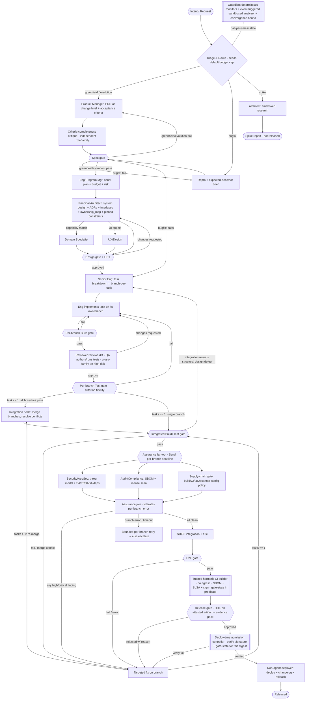

# Architecture — Graph topology, state, and orchestration

This document specifies *how* the Foundry pipeline is wired as a LangGraph
`StateGraph`: the node/subgraph layout, the typed state **and its concurrency
semantics**, the source-control isolation model, durability and side-effect
handling (including the dual-write / atomicity protocol), the context-assembly
contract, model-determinism policy, and the control flow (gates, loops, joins,
interrupts).

## 1. Top-level graph



Load-bearing control rules:

- **Single-entry / single-exit subgraphs; gate failures return to the route's
  producer** (Spec fail → `PROD` for greenfield/evolution, `MINSPEC` for bugfix).
- **Integration is task-count-based** (`tasks > 1` → `INTEG`; `tasks == 1` →
  `IBUILD`), so bugfix *and* single-task greenfield/evolution are both covered.
- **One re-verification funnel, dependency-scoped, with a convergence bound.**
  Every fix routes through `FIX`; multi-task fixes re-merge through `INTEG` (new
  tree → new `tree_sha`), single-task fixes go straight to `IBUILD`. A changed
  tree invalidates the integrated verdicts the change can affect; re-verification
  re-runs **only those** gates and **reuses cached runner-attested verdicts** for
  unaffected inputs (keyed on the unchanged input sub-hash), so the final attested
  gate-state still covers the whole tree at change-proportional cost
  ([governance.md §1f](./governance.md)). A **global convergence bound** (§7) stops
  the cross-gate "whack-a-mole" cascade that per-loop counters cannot (the
  loop-detector keys on a semantic signature, not the diff bytes — see
  [governance.md §3](./governance.md)).
- **Assurance fan-out uses `Send` with per-branch deadlines and an `error`
  status**, so one crashed/timed-out branch neither voids its siblings' committed
  results nor wedges the join (§5, [governance.md §3](./governance.md)).
- **Supply-chain gate** runs in the assurance fan-out: build/CI/IaC/Dockerfile/
  lockfile/scanner-config changes are high-privilege artifacts reviewed
  separately from application code ([governance.md §4](./governance.md)).
- **Attest-then-release-then-admit.** The trusted hermetic builder (no egress)
  produces the signature + SLSA provenance **with the gate-state bound into the
  predicate** *before* the Release gate; after human sign-off, a **deploy-time
  admission controller** re-verifies the signature *and* that all required gates
  PASS for this exact digest before a **non-agent deployer** ships
  ([governance.md §5](./governance.md)).
- **Independent criteria critique.** Greenfield/evolution criteria pass an
  independent completeness critique (esp. security/abuse criteria) before the
  Spec gate, so "100% criterion-coverage" can't be satisfied by weak criteria
  ([governance.md §6](./governance.md)).

## 2. Subgraphs

- `product_subgraph(intent) -> {PRD, acceptance_criteria}` (+ criteria critique)
- `architecture_subgraph(PRD) -> Design` (conditionally invokes UX / Domain Specialist; emits `pinned_constraints`)
- `implementation_subgraph(Design, task) -> branch` (per-task; evaluator-optimizer loop + per-branch Build/Test gates)
- `integration_node(branches[]) -> IntegratedTree` (runs only when `tasks > 1`)
- `assurance_subgraph(IntegratedTree) -> {SecurityReport, AuditReport, SupplyChainReport}` (`Send` fan-out + join)
- `release_subgraph(attested tree) -> Release` (admission controller + non-agent deployer)

> **The per-node inner loop is a pluggable adapter, not a core dependency.**
> `implementation_subgraph` (and, optionally, QA/Review/Security-triage nodes) run
> their plan→edit→test→iterate loop through a **coding-agent substrate contract**:
> **in** — a task packet (`pinned_constraints` + retrieved spans + a scoped
> sandboxed worktree + least-privilege tools + a turn/cost budget); **out** — a
> diff + test **sources** + `GateTriage`. The `served_family`/`served_model_id` are
> **not** taken from the adapter's self-report: the mediating model-provider proxy
> (§2b — the *only* credential holder) observes the actual provider/model each
> request hits and stamps a **proxy-observed `served_family`/`served_model_id`** into
> the run manifest per node. `served_family` is a **SET of lineage ids** (a single
> model maps to a one-element set; an ensemble maps to its full component-lineage
> set), not a scalar — so decorrelation is set-disjointness, not `!=` (below). An adapter-declared family that **disagrees** with
> proxy observation is **rejected**, and a node whose family the proxy cannot attest
> is **INELIGIBLE for high-risk judgment**. Adapters: Claude Code (`claude -p`),
> OpenAI Codex CLI (`codex exec`), OpenHands/SWE-agent, or a raw multi-provider ReAct
> loop. Because the substrate is a swappable seam, a high-risk review/QA node can be
> required to run a **different proxy-observed family** than the implementer it
> checks — preserving the judge decorrelation the model tiering depends on
> ([PLAN §6](../PLAN.md)).
>
> **Two verdict kinds — adapters never sign a deterministic-gate verdict, but
> judgment nodes do emit a judgment verdict.** For deterministic gates the adapter
> emits only a diff + test **sources** + `GateTriage`; the *signed
> deterministic-gate verdict* is computed and signed solely by the trusted
> two-zone runner (the forged-results-stream defense — [governance §1c](./governance.md)).
> But LLM-judgment seams (Review approve/request-changes, Threat-review residual,
> perceptual class-5) legitimately emit a **judgment verdict** that routes the
> evaluator-optimizer loop — there is no deterministic oracle to sign one. The
> integrity controls on a judgment verdict are **cross-family decorrelation**
> (below) and, *where an HITL edge exists*, HITL; the blanket "never a verdict" does
> not apply to these nodes. **HITL coverage is uneven and must not be overstated:**
> only Design/Release/escalation seams have a human edge (§9). **The per-task Review
> verdict has no HITL edge** — it is bound by **decorrelation ALONE**, so the
> trusted-grounded proxy-observed `served_family` above is **MANDATORY (not
> optional)** for Review, and Review additionally carries a **sampled/triggered
> trusted cross-check** (a cross-family independent re-judgment on a sampled or
> risk-triggered fraction) so the decorrelation-only seam is not the sole control.
> Do not claim HITL covers Review. **In decorrelation-relaxed degraded mode this
> sampled cross-check is itself cross-family and therefore unsatisfiable in the same
> outage that triggered degraded mode** — so in degraded mode the sampled trusted
> cross-check is **REPLACED BY (not supplemented with) the mandatory HITL** of §2/§8;
> it is **never silently run same-family**.
>
> **Judgment-verdict integrity binding.** Judgment verdicts are *not* in
> `DETERMINISTIC_GATES`, so `_merge_gates` does not attestation-gate them (§3) — an
> agent inside the implementing adapter could otherwise forge or replay an "approve"
> into the live `gates` channel. Every judgment verdict must therefore carry a
> **judgment-verdict binding** `(node_id, proxy-observed served_family SET, status,
> verdict_nonce, lineage_map_revision, state_sha, subject_artifact_uri)` produced
> **OUTSIDE the implementing adapter** (proxy- or orchestrator-stamped, never
> adapter-self-signed). `_merge_gates` **rejects judgment-verdict writes whose
> binding does not validate**. Keying the binding on `state_sha` prevents replaying a
> stale "approve" across trees/forks; **binding `status` (+ a per-verdict
> `verdict_nonce`) prevents the same-tree verdict-FLIP** — without it an agent can
> copy a genuine reviewer's binding (same `node_id`/`served_family`/`state_sha`/
> `subject_artifact_uri`), set `status="approve"`, re-emit at a higher `seq`, and
> have `_merge_gates` take the forged approve; since the per-task Review seam has **no
> HITL** (below), that flip would defeat the only gate stopping injected code. A
> flipped `status` no longer matches the stamped binding and fails
> `verify_judgment_binding` (§3, §4).
>
> **The bound `status` must come from a TRUSTED verdict-derivation path, never the
> implementing adapter's free-form output.** Signing `status` only defends the
> verdict if the stamper obtains an *authentic* `status` — if the out-of-adapter
> stamper simply takes the adapter's free-form result text, a compromised adapter
> reports `status="approve"` and gets that **forged verdict faithfully signed** (the
> binding would attest a lie). Therefore the high-risk Review judge runs through a
> **trusted harness emitting a GRAMMAR-CONSTRAINED / structured verdict channel** that
> the **§2b mediating proxy observes and binds INDEPENDENT of the adapter's
> post-processing** — the proxy/orchestrator **owns verdict-extraction** from that
> structured channel — **OR** the high-risk Review verdict is emitted by a node
> **OUTSIDE the implementing adapter entirely**. A `status` taken from the
> implementing adapter's free-form output **does NOT satisfy the binding** and is
> rejected.
>
> **Decorrelation binds proxy-observed served lineage, not adapter brand.**
> OpenHands, the raw loop, *and* Claude Code can each drive any model, so the brand
> carries no lineage guarantee — and the adapter's *self-declared* family is
> untrusted (above). The decorrelation invariant is always evaluated over the
> **proxy-observed `served_family`**, never the adapter's self-report.
>
> - **Generalized over all judge↔subject seams.** The deterministic, admission-/CI-
>   checked invariant covers **every** judge↔subject seam — at minimum
>   {reviewer↔implementer, test-author↔implementer, criteria-critic↔PM} — and fails
>   **closed** on high-risk judgment when the two sides' proxy-observed
>   `served_family` **sets intersect**, independent of brand. (Earlier drafts scoped
>   this to reviewer↔implementer only.)
> - **`served_family` is a SET of curated lineage-EQUIVALENCE-CLASS ids, and the
>   invariant is set-DISJOINTNESS.** Decorrelation holds iff
>   `reviewer.served_family ∩ implementer.served_family == ∅`; a scalar `!=` is
>   **wrong** — an ensemble/router judge can share *one* component lineage with the
>   implementer yet pass a scalar `!=`, so the seam must compare sets and fail closed
>   on any shared lineage. Each id is a **versioned, human-curated mapping keyed on
>   base-model lineage** — explicitly **not** provider brand and **not** the model-id
>   string — held under the **scanner-config trust boundary** (§SEC1 /
>   [governance.md §4](./governance.md)) at a recorded `lineage_map_revision` (below).
>   Fine-tunes and distillations **inherit their base lineage** (a one-element set);
>   an **ensemble** has the proxy stamp its **full component-lineage set** and
>   decorrelates only if that set is disjoint from the other side's. A **per-request
>   router** (one model-id that may dispatch to differing lineages per call) must be
>   **pinned to a non-routing model-id** so the proxy can stamp a stable set, or it is
>   **ineligible for high-risk judgment** (the proxy cannot attest a stable lineage
>   set for it).
> - **Decorrelation-aware failover, degraded mode (the 2-family deadlock).** With
>   only two provisioned families, decorrelation-aware failover (§8) can **deadlock
>   both arms** (each needs the other's family) or be forced into a correlated
>   config. Policy: **provision ≥3 lineages** so high-risk decorrelation survives a
>   single-family outage; OR enter an explicit **"decorrelation-relaxed + mandatory
>   HITL" degraded mode** when only a shared surviving family remains. In that
>   degraded mode the **subject side proceeds and the judge side pauses** for the
>   mandatory human cross-check (the judge is the seam that loses its independence),
>   consistent with "T1 never auto-downgrades." The node **never silently fails over
>   into a correlated configuration**. In this mode the Review seam's sampled trusted
>   cross-check — itself cross-family, hence unsatisfiable in the same outage — is
>   **replaced by** that mandatory HITL, **never run same-family** (above).
>
> **The adapter boundary is ENFORCED by the sandbox, not asserted** — the adapter
> runs arbitrary bash, so "writes worktree only / no external side-effect" must be
> a property of the cage, not a promise: (a) the **only** writable mount is the
> task worktree; (b) the **only** network route is a **mediating model-provider
> proxy** that holds the provider credential, injects the system prompt/SOP/tools,
> content-scans + schema-validates egress bodies against the task data profile, and
> meters tokens/USD/entropy — no git remote, no registry except the hash-pinned
> mirror reached *through* the proxy; (c) outbox, result-channel, and credential
> endpoints live in namespaces the adapter process tree cannot address (separate
> netns, no FD/socket inheritance, no shared mount); (d) the sandbox is destroyed
> and rebuilt between the untrusted-execution phase and any credentialed phase — no
> reuse.
>
> **The provider response path is guarded, and the provider is a trusted SPOF.** The
> proxy guards *egress* (request bodies), but the model **response** returns through
> it and the adapter writes it to the worktree — so indirect prompt-injection or a
> poisoned/compromised provider can plant code that **the adapter's own tests are
> authored to pass** (the adapter authors both the change and its tests). Therefore:
> (a) the **provider is now a trusted component**, and the single-credential proxy is
> an acknowledged **trust SPOF** (one mediating egress path, one credential holder);
> (b) the proxy **tags/segregates provider output that originated from untrusted
> retrieved context** so downstream treats it as tainted; (c) injected behavior is
> caught **not by the adapter's own tests** but by the **cross-family independent
> oracle** (the decorrelated judge/test-author of the §2 invariant, [evaluation.md
> §4](./evaluation.md)) and **threat-review HITL** (§9). The adapter's self-authored
> tests are explicitly **not** trusted to detect provider-injected behavior.
>
> **Adapter vs superstep atomicity, budget, and cancellation.** The adapter runs a
> long multi-turn loop *inside one superstep*, so superstep-boundary budget
> enforcement and the cooperative-cancellation token (§6) — which a third-party CLI
> does not poll — do **not** bind it, and a mid-loop crash would discard all
> uncommitted work. The contract therefore requires: (a) **incremental resumable
> progress via a content-addressed turn-snapshot** — each adapter turn commits to a
> content-addressed snapshot (a git commit / CAS object) whose **`turn-snapshot
> handle`** is written in the **SAME Postgres outbox transaction** as the resumable
> marker (§5), so the worktree is never a third durable store outside the checkpoint
> transaction. On resume the worktree is **reconstituted from the last
> transactionally-recorded `turn-snapshot handle`** and any uncommitted filesystem
> delta is **discarded**; turn-boundary writes are **atomic** (temp+fsync+rename, or
> a single git commit). The runner **never attests a tree that is not a clean
> function of committed state** — `tree_sha` is computed only over a recorded
> snapshot, never a partially-applied turn. Budget/cancellation are enforced at
> **adapter-turn boundaries** (a sub-superstep meter), not only at LangGraph
> superstep boundaries; (b) the adapter is **metered and hard-killed from outside**
> (proxy token/USD accounting + cgroup CPU/wall-clock + `SIGKILL` at cap) —
> adapter-reported budget is **advisory only**; (c) **within-adapter-loop
> non-convergence must be observable.** The superstep-granular loop-detector and
> sampled analyzer (§7, [governance.md §3](./governance.md)) cannot see a turn loop
> *inside* one superstep, so absent (c) only the hard-kill bounds it — a late, wrong
> diagnosis (spend breach, not non-convergence). Adapters must emit **per-turn
> trusted-infra-observed progress signals** (proxy/runner-observed, not
> adapter-self-reported) into the sub-superstep meter; the **semantic loop-signature
> and sampled-analyzer scope extend to adapter-turn granularity**. Adapters that
> cannot emit such signals are **bounded only by spend** (acknowledged limitation);
> (d) an adapter that cannot meet the incremental-progress + external-meter +
> progress-signal contract is **ineligible** for the substrate. *Which adapters can
> meet it is an open integration question.*

### 2b. The mediating model-provider proxy

The proxy is referenced throughout §2 as the **only credential holder**, the
**enforced** network route out of the sandbox (§2(b)), the egress guard, **and** the
stamper of proxy-observed `served_family`/`served_model_id` and judgment-verdict
bindings (§3). It is therefore **the single most load-bearing trusted component for
decorrelation** — every decorrelation guarantee reduces to trusting its lineage
observation. Its mechanics:

- **model-id → lineage observation/resolution.** The proxy does **not** trust the
  adapter's declared model. It observes the **actual** provider endpoint + served
  model-id each request hits (from the credentialed request it itself issues, plus
  the provider's returned `model`/system-fingerprint, §8), then resolves that
  observed model-id through the **curated lineage-equivalence map** (the
  scanner-config-boundary artifact, §2/§4) at the current `lineage_map_revision` to a
  **`served_family` SET of lineage ids** (one element for a single model, the full
  component set for an ensemble, §2). A router whose served model-id is not pinned to
  a stable lineage resolves to **no attestable set** → the node is ineligible for
  high-risk judgment (§2). The resolved set + `served_model_id` +
  `lineage_map_revision` are stamped into the run manifest per node and into the
  judgment-verdict binding (§3).
- **trusted verdict-extraction (the bound `status` source).** For a high-risk Review
  judgment the proxy does **not** take the verdict from the adapter's free-form output —
  a compromised adapter would just report `status="approve"` and have it authentically
  signed. The judge runs through a **trusted harness exposing a grammar-constrained /
  structured verdict channel**; the proxy **observes and extracts `status` from that
  channel independent of the adapter's post-processing** (the proxy/orchestrator owns
  verdict-extraction) and binds *that* `status` into the judgment-verdict binding (§3),
  OR the Review verdict is emitted by a node **outside the implementing adapter
  entirely**. A `status` derived from the implementing adapter's free-form output does
  **not** satisfy the binding.
- **grounding / audit of the resolution.** The map itself is curated and versioned
  under the scanner-config trust boundary ([governance.md §4](./governance.md)), so
  the resolution is only as sound as that revision — which is why
  `lineage_map_revision` is bound into the verdict and **re-checked at admission**
  (§4): a CI-vs-admission map drift or a lineage-splitting edit is caught as a
  superseded-revision alert rather than silently changing a verdict. The
  provider-observed model-id + system-fingerprint are recorded in the WORM store, so
  a stamped lineage is **auditable against what the provider actually served**, and a
  fingerprint change raises the pinned-ID-drift alert (§8).
- **trust + availability model.** The proxy is an acknowledged **trust SPOF** (one
  mediating egress path, one credential holder, §2) **and** the only stamper of
  proxy-observed lineage — a compromised or unavailable proxy collapses decorrelation
  attestation, not just egress. It is operated as a **trusted component outside the
  adapter blast radius** (separate netns/namespaces the adapter cannot address,
  §2(c)); its availability is treated as a first-class dependency — on proxy
  unavailability the affected high-risk-judgment nodes **pause-and-escalate** rather
  than fall back to adapter self-report (same fail-closed discipline as the
  no-auto-downgrade and degraded-mode rules, §8). The provider behind it is itself a
  trusted component (§2, response-path SPOF).

## 3. Typed state and concurrency semantics

LangGraph merges updates **per channel** at each superstep, folding the pending
writes as an **unordered set**. Reducers must therefore be **associative *and*
commutative**, **`None`-safe**, and must establish ordering from data (a
monotonic field) rather than iteration order. Large/append-only data is held
**out-of-band by content-addressed handle** to bound checkpoint size.

```python
import operator
from typing import Annotated, TypedDict
from pydantic import BaseModel
from enum import Enum

Seq = tuple[str, int, int, str, int]  # (run_id, emission_epoch, superstep_index, node_id, local) — see "Seq" below
                                       # emission_epoch is ordered AHEAD of superstep_index so a re-execution
                                       # always outranks the record it supersedes (superstep_index is NOT
                                       # monotonic across resume — a re-executed node keeps its langgraph_step)

class Artifact(BaseModel):
    kind: str
    uri: str                       # content-addressed store ref — GLOBALLY UNIQUE identity
    produced_by: str
    task_id: str | None = None
    version: int = 1
    supersedes: str | None = None
    seq: Seq                       # TOTAL causal order (no ties) — see "Seq"

class GateResult(BaseModel):
    name: str
    status: str                    # "pass" | "fail" | "error"  (error = infra failure, not a verdict)
    decision_deterministic: bool
    execution_deterministic: bool
    # For deterministic gates the verdict is WRITTEN ONLY by the trusted attestor (zone B,
    # governance §1c); the signature binds the verdict to its inputs so it can't be replayed:
    verdict_class: str             # config-evaluable | execution-deterministic | statistical | human-witnessed | perceptual (domains.md §1)
    runner_attestation: str | None # sig over (name, state_sha, scanner_config_rev, lineage_map_revision, status, results_digest); human sig for class "human-witnessed"
    verdict_nonce: str | None      # judgment verdicts only: the single-use server-issued challenge bound into judgment_binding; _merge_gates READS its consumed status from the global record set (it does NOT consume it) — see judgment_binding + _merge_gates
    judgment_binding: str | None   # judgment verdicts only: binding over (node_id, proxy-observed served_family SET, status, verdict_nonce, lineage_map_revision, state_sha, subject_artifact_uri), stamped OUTSIDE the implementing adapter; _merge_gates rejects writes whose binding doesn't validate (binding status defeats a same-tree verdict-flip replay). verdict_nonce is a server/orchestrator-issued, per-review-request challenge, single-use and freshness-verified at reducer-time AND admission (mirroring the class-4 server_nonce); consumption + the negative-verdict latch live in the GLOBAL cross-fork transactionally-committed record set, NOT in _merge_gates, which only READS them. Consumption is keyed on the verdict's content identity so re-folding an already-accepted write is idempotent. Negative judgment verdicts LATCH monotonically, keyed on cross-fork-stable (node_id, subject_artifact_uri, state_sha) so a sibling fork inherits it — a request-changes (or trusted cross-check rejection) cannot be superseded by re-emitting an older approve for the same key, exactly as deterministic stable-FAILs latch; released only by a fresh, nonce-bound re-review (so _merge_gates is NOT pure max-by-seq for judgment verdicts)
    results_digest: str | None     # class 1/2: hash of raw zone-A results; class 3: (metric, dataset_hash, seed, n, estimate, ci, decision)
    findings: list[str] = []
    retries: int = 0
    run_against: str               # per-branch: "task/<id>"; integrated: state_sha (tree_sha + data/weight refs, see §4 + domains.md §2)
    seq: Seq                       # TOTAL causal order across runs AND forks; never iteration order

class GateTriage(BaseModel):       # agents write THIS, never GateResult, for deterministic gates
    name: str
    run_against: str
    explanation: str               # triage/remediation notes; advisory, never a verdict
    produced_by: str
    seq: Seq

class LogRef(BaseModel):           # handle to out-of-band data (history/large artifacts)
    uri: str                       # append-only store / object store
    count: int                     # number of records, for cheap reads
    head_seq: int

class FactoryState(TypedDict):
    request: str                                              # single-writer
    route: str | None                                         # single-writer (triage)
    phase: str                                                # single-writer (supervisor)
    required_capabilities: Annotated[list[str], _union]       # fan-in, deduped, commutative
    pinned_constraints: Annotated[list[dict], _merge_constraints]  # fan-in; relevance-scoped, supersedable (§8)
    artifacts: Annotated[list[Artifact], _merge_by_uri]       # fan-in, set-union by uri (commutative)
    gates: Annotated[list[GateResult], _merge_gates]          # fan-in, max-by-seq per (name, run_against); deterministic-gate writes require valid attestation
    gate_triage: Annotated[list[GateTriage], _union_by_key]   # fan-in; agent triage notes (never verdicts)
    tasks: Annotated[list[dict], _union_by_id]                # fan-in, keyed (commutative)
    budget: BudgetLedger                                      # single-writer (Budget Ctrl); meters token AND compute (GPU/external-job) cost — domains.md §3
    actions: Annotated[list[ExternalAction], _union_by_key]   # fan-in, keyed by idempotency_key
    history_ref: LogRef                                       # handle; raw events live out-of-band
```

Reducer rules (all `None`-safe, commutative, identity-keyed):

```python
def _merge_by_uri(a, b):                      # artifacts: set-union by content address
    m = {x.uri: x for x in (a or [])}
    for x in (b or []): m[x.uri] = x
    return list(m.values())

def _merge_gates(a, b):                        # gates: LATEST BY seq per (name, run_against)
    m = {}
    for g in (a or []) + (b or []):
        # Deterministic-gate verdicts are accepted ONLY with a valid runner attestation,
        # so an unsigned agent write can never supersede the trusted runner's verdict:
        if g.name in DETERMINISTIC_GATES and not verify_attestation(g):
            continue
        # Judgment verdicts are NOT in DETERMINISTIC_GATES, so they bypass the attestation
        # check above — instead they must carry a judgment-verdict binding stamped OUTSIDE
        # the implementing adapter; reject any whose binding doesn't validate (anti-forge/replay):
        if g.name in JUDGMENT_VERDICTS:
            if not verify_judgment_binding(g):
                continue                       # binding = (node_id, proxy-observed served_family SET, status,
                                               #            verdict_nonce, lineage_map_revision, state_sha,
                                               #            subject_artifact_uri). state_sha keying blocks
                                               #            cross-tree/fork replay; binding STATUS (+ nonce)
                                               #            blocks a same-tree verdict-FLIP (copy a genuine
                                               #            reviewer's binding, set status="approve", re-emit) —
                                               #            a flipped status fails verify_judgment_binding (§4)
            # verdict_nonce is a server/orchestrator-issued, per-review-request challenge,
            # single-use + freshness-verified at reducer-time AND admission (mirrors class-4
            # server_nonce). _merge_gates is PURE: it READS the GLOBAL, cross-fork,
            # transactionally-committed consumed/latched record set (alongside the class-3
            # look-ledger and stable-FAIL latch) and NEVER mutates it. Consumption is keyed on
            # the verdict's CONTENT identity, so re-folding an already-accepted write is
            # idempotent (no "consume on first write" side-effect inside the reducer):
            if nonce_consumed_by_other_verdict(g):  # READ-only: consumed by a DIFFERENT content identity
                continue
        k = (g.name, g.run_against)
        if g.name in JUDGMENT_VERDICTS and negative_verdict_latched(g):
            continue                           # NEGATIVE-VERDICT LATCH (NOT pure max-by-seq for judgment
                                               #   verdicts), READ from the global cross-fork record set keyed
                                               #   on (node_id, subject_artifact_uri, state_sha): a request-changes /
                                               #   trusted-cross-check rejection cannot be superseded by re-emitting
                                               #   an OLDER approve for the same key — exactly as deterministic
                                               #   stable-FAILs latch; released only by a FRESH server-issued
                                               #   nonce bound to a genuine re-review. The reducer only READS
                                               #   this committed status; it never writes the latch.
        if k not in m or g.seq > m[k].seq:     # TOTAL tuple order — ties are impossible; emission_epoch
            m[k] = g                           #   (ahead of superstep_index) makes a re-execution outrank
    return list(m.values())                    #   the stale record it supersedes, never tie it
```

Judgment-verdict nonce consumption and the negative-verdict latch live in the
GLOBAL, cross-fork, transactionally-committed record set (alongside the class-3
look-ledger and the stable-FAIL latch) — NOT inside `_merge_gates`. The
negative-verdict latch is keyed on cross-fork-stable identity
`(node_id, subject_artifact_uri, state_sha)`, persisted to the WORM/global store
so a sibling fork (new `run_id`) inherits it; it is surfaced cross-fork at the
Review→loop routing point and re-checked at E2E/Release exactly like the digest
stable-FAIL latch, and released only by a fresh server-issued nonce bound to a
genuine re-review. `_merge_gates` stays a pure, commutative, replay-deterministic
function that READS consumed/latched status as committed input and never mutates
it; nonce consumption is keyed on the verdict's content identity so re-folding an
already-accepted write is idempotent. *(DS-R22-F1)*

**Seq — a total, race-free causal order *within* a run; globally unique across
runs.** `seq` is **not** a shared mutable counter (parallel branches share one
immutable input snapshot and could not read-increment one without a race). It is
the lexicographic tuple `(run_id, emission_epoch, superstep_index, node_id, local)`:

- `run_id` — a **globally-unique** run/fork identifier (e.g. a ULID allocated at
  run/fork creation), recorded in the WORM record. It is **not** monotonic across
  concurrent forks, and that is fine: **cross-fork verdict resolution does not
  depend on `seq` order at all** — `_merge_gates` runs per-run (it never sees two
  forks' channels), and *across* runs the admission controller is **fail-closed**
  ([governance.md §5](./governance.md)), not seq-ordered. `run_id` is present
  purely so two forks' records for the same `tree_sha` are *distinct identities*
  in the WORM/predicate stores, never colliding. *(DS-R9-F1, DS-R10-F3)*
- `emission_epoch` — a **durable per-`(run, key)` resume-generation counter**,
  incremented **in the committing transaction** on every (re-)execution of the node
  that emits a given key, and ordered **AHEAD of `superstep_index`**. This exists
  because `superstep_index` is **NOT monotonic across resume**: a re-executed node
  gets the **same** `langgraph_step`, so a re-emitted `GateResult` would *tie* (not
  outrank) the stale record and `g.seq > m[k].seq` would keep the **stale** one.
  With `emission_epoch` first, a re-execution always outranks the record it
  supersedes. **Do not derive monotonicity from `langgraph_step`.**
- `superstep_index` — read from LangGraph **run config metadata at emit time**
  (`config["metadata"]["langgraph_step"]`); monotonic *within a single execution
  pass* and **constant across all branches of one `Send` fan-out** (hence the
  tie-breakers below). It orders writes *within* one epoch but, being non-monotonic
  across resume, is **not** the field that makes a retry/rebase outrank a prior
  write — `emission_epoch` is.
- `node_id` — deterministic id of the emitting node, separating distinct siblings
  in one fan-out. For *same-node-id* branches (branch-per-task), separation comes
  from the channel **key** (`run_against`), not `seq`. For `Send` fan-out
  emissions to a **non-keyed** channel (same `node_id`, same `superstep_index`),
  the per-item **branch key** is folded into `seq` — otherwise siblings collide;
  alternatively every fan-out-written channel must be **key-deduped/commutative and
  never `seq`-ordered** (the reducer-invariant test asserts whichever discipline
  the channel adopts).
- `local` — per-node monotonic counter for multiple emissions by one node. It must
  be a deterministic function of the emission's node-internal **logical position**,
  **not wall-clock emission order** — OR all channel writes must be content/key
  idempotent so a replayed write coalesces. Otherwise LLM-nondeterministic
  re-execution assigns a different `seq`/key to a logically-identical write,
  duplicating or mis-ordering gate records on replay. **This replay-determinism
  requirement is mandatory.**

Within a run `run_id` is constant, so `(emission_epoch, superstep_index, node_id,
local)` gives a **total** order — no equal-`seq` fallthrough to fold order — which
is all `_merge_gates` needs (it only ever folds writes of one run). A reducer
invariant test asserts order-independence per key **and** that a re-executed node's
re-emitted record (same `langgraph_step`, higher `emission_epoch`) strictly
outranks the stale record it supersedes. *(DS1, DS2, DS8, DS-R9-F1, DS-R9-F3, DS-R10-F3)*

Why each fix matters:

- **`gates` is max-by-`seq` over a total order *and* attestation-gated**, so a
  real PASS can't be masked by a stale FAIL regardless of fold order, **and an
  unsigned agent write can never supersede the trusted runner's deterministic-gate
  verdict in the live channel** — agents write only `GateTriage`
  ([governance.md §1c](./governance.md)). The total order is led by `emission_epoch`
  so a **re-execution after resume strictly outranks** the stale record it
  supersedes (a non-monotonic `langgraph_step` alone would tie it). **Judgment
  verdicts** (not in `DETERMINISTIC_GATES`) are instead gated on a valid
  **judgment-verdict binding** stamped outside the adapter, so a forged/replayed
  "approve" is rejected — the binding includes `status` (+ `verdict_nonce`), so a
  same-tree **verdict-flip** (copy a genuine binding, set `status="approve"`, re-emit
  higher-`seq`) fails validation, not just cross-tree replay. The `verdict_nonce` is
  **single-use** (server/orchestrator-issued per review request, freshness-verified
  at reducer-time AND admission like the class-4 `server_nonce`); its **consumption
  and the negative-verdict latch live in the GLOBAL, cross-fork,
  transactionally-committed record set — NOT inside `_merge_gates`**, which only
  **READS** that committed status and never mutates it (so the reducer stays pure,
  commutative, and replay-deterministic, and a LangGraph re-fold on resume is
  idempotent because consumption is keyed on the verdict's content identity). This
  way even a **genuine, still-valid `approve` binding cannot be REPLAYED** at a
  higher `seq` to mask a later `request-changes`; and negative judgment verdicts
  **LATCH monotonically** — `_merge_gates` is therefore **not pure max-by-`seq` for
  judgment verdicts**: a `request-changes` (or trusted cross-check rejection),
  latched on cross-fork-stable `(node_id, subject_artifact_uri, state_sha)` so a
  sibling fork (new `run_id`) inherits it, cannot be superseded by an older
  `approve`, exactly as deterministic stable-FAILs latch, surfaced at the
  Review→loop routing point and re-checked at E2E/Release, released only by a fresh
  server-issued nonce bound to a genuine re-review. In-graph routing and the HITL
  evidence pack read the attested record. *(DS1, DS2, DS8, DS-R9-F2, DS-R22-F1)*
- **`status` distinguishes `error` from `fail`** — an infra crash is not a
  verdict; the join handles it separately (§5). *(DS7)*
- **All list channels are keyed set-unions** (`tasks` by id, `actions` by
  idempotency key), so no channel relies on `operator.add` concatenation order
  for meaning; anything order-sensitive reads by `seq` and sorts. *(DS8)*
- **`history` and large artifact bodies live out-of-band** (`history_ref` +
  object store); the checkpoint holds bounded handles, so checkpoint size doesn't
  grow with trajectory length and Postgres write-amplification stays linear in
  *new* data, not total. *(DS9)*
- **`pinned_constraints`** is a first-class, never-summarized channel (§8). *(AI2)*

## 4. `tree_sha` — precise, behavior-stable definition

The integrated-gate keying and invalidation correctness depend on `tree_sha`
being a deterministic hash of *logical state that affects behavior* and nothing
volatile. It is defined as:

```
tree_sha = H( normalized_source_tree   # git tree of TRACKED SOURCE only,
                                        #   build outputs excluded via .gitattributes/.gitignore,
                                        #   canonical path ordering, no embedded timestamps
            ⧺ resolved_lockfile_hash    # exact dependency versions (all ecosystems)
            ⧺ toolchain_digest          # pinned builder image + tool versions
          )
```

- **Excludes** build artifacts, caches, and any codegen-embedded timestamps, so
  the *same logical state hashes identically across clean checkouts on different
  machines* (a CI invariant test enforces this). This kills spurious
  invalidation → the cascade in §7. *(DS4)*
- **Includes** the resolved lockfile and toolchain digest, so a dependency or
  toolchain change *does* change the hash — two different logical states cannot
  collide into a stale "already verified" PASS. *(DS4, ties to supply-chain §SEC1)*
- Integrated `GateResult.run_against = tree_sha`. A `FIX` (re-merged for
  multi-task) yields a new `tree_sha`, so prior Security/Audit/Supply-chain/E2E
  verdicts no longer match the current key and are re-run.
- **Execution-dependent verdicts depend on inputs *not* in `tree_sha`.** Cached
  runner-attested Test/E2E/SAST verdicts also depend on the rotating held-out
  **mutant family** and the **scanner rule-set version** — neither is in the source
  tree. The **mutant-rotation-id + scanner-rule-version** are therefore bound into
  the **attestation tuple** *and* the **dependency-scoped reuse key**, so a cached
  class-2 (execution-dependent) verdict is invalidated across a rotation /
  rule-version boundary and is **not** reused across it. *(ties to §SEC1)*
- **`lineage_map_revision` is bound and re-checked at admission like
  `scanner_config_revision_hash`.** The revision of the curated lineage-equivalence
  map (the set that resolves `served_family`, §2) is bound into **both** the
  judgment-verdict binding (§3) **and** the attestation tuple, and is
  **RE-CHECKED at admission** exactly as `scanner_config_revision_hash` is. Without
  this, a map edit that splits one real lineage into two labels makes a
  genuinely-same-lineage pair compare **disjoint** — a **vacuous decorrelation** pass
  with no detectable fingerprint — and CI-vs-admission map drift would **silently
  change the verdict**. Admission **alerts on any verdict resolved under a superseded
  `lineage_map_revision`** and fails closed. *(ties to §SEC1, §2, §3)*
- **Mutant-rotation reuse vs forward-invalidation.** Bounded reuse (avoid
  re-grounding every cached verdict) is in tension with *forward-invalidating* an
  exposed rotation (a verdict grounded on a leaked mutant set must not be laundered
  forward). Resolution: `mutant_rotation_id` is **monotonic**, and "a newer rotation
  exists" is **decoupled** from "a prior rotation is exposed/retired." A cached
  class-2 verdict is reusable **only while its grounding rotation is still in the
  ACTIVE, UNEXPOSED set** — so a newer rotation does *not* by itself invalidate it,
  but an **exposure event** does, preventing an exposed-rotation verdict from being
  reused. A rotation-exposure event triggers a **re-grounding load spike** that
  [operations.md §6/§8](./operations.md) sizes as a first-class correlated event
  (like fleet model drift). *(ties to §SEC1)*
- **`state_sha` generalization (data/ML domains).** For software whose behavior
  depends on data or model weights, `tree_sha` is the source-only special case of
  `state_sha = H(source ⧺ lockfile ⧺ toolchain ⧺ data_refs ⧺ feature_defs ⧺
  weight_refs)`, where data/weight **content identities** (manifest hashes) enter
  the key while the bytes stay in their external versioned stores. This makes
  dependency-scoped re-verification *sound* for ML — a dataset/label/weight change
  dirties the data-dependent gates instead of reusing a stale cached PASS
  ([domains.md §2](./domains.md)). A pack declares which refs are data vs weights. Per-branch verdicts
  key on the stable `task/<id>` and are invalidated when that branch's base moves
  (rebase resets the branch; its verdicts are re-emitted with a higher `seq`).

## 5. Durability, atomicity, and external side effects

Resume restores *internal* state; it does not undo external effects. The dual
-write between the checkpoint DB and the outside world (git, GitHub, deploys,
WORM audit) is handled by a **transactional outbox**, not by hope.

- **The outbox is the *only* durable-effect surface.** Every external effect is
  Foundry's explicit outbox enqueue, derived from the **validated worktree diff**.
  Because the sandbox denies the adapter all network/git egress (§2(b,c)), the
  adapter **cannot** produce an external effect directly — which is precisely what
  makes "writes worktree only" an *enforced* property rather than an assertion.

- **One Postgres transaction** commits, per superstep: the LangGraph checkpoint,
  the `budget` ledger, the `actions` ledger update, the current adapter
  **`turn-snapshot handle`** (below), **and** an **outbox** row for every external
  effect and every audit event. The checkpoint and the ledgers can never diverge. *(DS3)*
- **The worktree is never a third durable store outside the checkpoint
  transaction.** The incremental-progress contract (§2) reintroduced the dual-write
  divergence: the worktree is a durable filesystem mutated *outside* the checkpoint
  transaction, so a mid-superstep crash/`SIGKILL` could leave it mutated but
  uncheckpointed, and `tree_sha` could be computed over a partially-applied turn.
  Resolution: each adapter turn commits to a **content-addressed snapshot** (git
  commit / CAS object) whose **`turn-snapshot handle`** is written in the **SAME
  Postgres outbox transaction** as the resumable marker (above). On resume the
  worktree is **reconstituted from the last transactionally-recorded handle** and any
  uncommitted filesystem delta is **discarded**; turn-boundary writes are **atomic**
  (temp+fsync+rename, or a single git commit). The runner therefore **never attests a
  tree that is not a clean function of committed state**. *(DS3, ties to §2, §4)*
- **A separate relay** drains the outbox to external systems (git/PR/tag/deploy)
  and to the **append-only WORM audit store**, at-least-once, each carrying its
  `idempotency_key`. *(DS3)*
- **Effectful tools are idempotent at the external boundary**, via one of three
  paths in priority order: *(DS2)*
  1. **External client key** — the `idempotency_key` is transmitted to and
     stored by the external system (deploy idempotency token; GitHub client
     token); resume **re-queries by key**.
  2. **Embedded marker** — where no client key exists but the effect is
     queryable, the key is embedded (branch/tag name, PR marker commit) and
     resume re-derives existence.
  3. **Foundry-side dedup record** — for effects whose system supports *neither*
     (fire-and-forget webhooks, notifications, registries with no by-key lookup),
     the relay writes a **local dedup row in the same outbox transaction** and
     consults it before emitting, giving effectively-once delivery (true
     exactly-once being impossible). **Path 3 is reserved for effects whose
     duplicate-or-omission is tolerable (notifications) — never for anything a
     gate, release, or deploy depends on** — because a crash between *act* and
     *confirm-log* on a non-queryable effect resolves to **fail-to-human**, not
     autonomous dedup. *(DS-R9-F4)*

  The protocol is **intent-log → act → confirm-log**; if none of the three can
  establish state on resume, the node **fails to the human** (never assumes). *(DS2, DS3-F3)*
- **All idempotency / dedup / marker records — *the class-3 alpha-spending
  look ledger*, *judgment-verdict nonce consumption*, and *the negative-verdict
  latch* (keyed on `(node_id, subject_artifact_uri, state_sha)`) — are GLOBAL**
  (run-independent): they survive checkpoint forks, and
  fork-recovery replay re-queries them exactly as an ordinary resume does. So a
  poisoned-checkpoint fork **never re-fires** a path-2 or path-3 effect — the global
  record already reflects the prior emission regardless of which run/fork produced
  it. **Forking does NOT reset class-3 alpha:** governance owns the look-ledger
  mechanics ([governance.md §3](./governance.md)). The class-3 alpha look-ledger is keyed on `(eval_set_identity, decision_id)` — NOT on `state_sha`. `decision_id` is the pre-registered, content-derived identity of the *acceptance question* — `H(eval_set_lineage ⧺ threshold ⧺ metric_family ⧺ decision_rule)` — explicitly INVARIANT to `weight_refs`/`feature_defs`/`label_version`, so a new `decision_id` requires a genuinely new pre-registered objective, not a new candidate; `decision_id` minting is a deterministic, runner-/HITL-gated, WORM-logged event, never agent-self-issued. An eval-set rotation does NOT reset alpha: remaining alpha carries forward into the rotated set under a linked `decision_id` lineage, and the rotation is itself an alpha-spending, runner-/HITL-gated, WORM-logged event. The ledger is GLOBAL/cross-fork (survives `run_id` change); `state_sha` is recorded per-look for audit only.
- **Checkpointer:** `PostgresSaver` (prod) / `SqliteSaver` (dev).
- **Time-travel** rewinds *internal state only*; forking creates a **new run ID**,
  never mutates the original WORM record, and replaying past an effectful node
  hits the external idempotency check and skips.
- **Cross-fork stable-FAIL latch is queryable at the E2E/Release gate, not only at
  deploy-admission.** The per-run `gates` reducer (§3) folds one run's channels and
  cannot see a *sibling fork's* stable-FAIL latch on the same digest — so without
  this a fork could consume the full human Release sign-off before deploy-admission
  bounces it. The stable-FAIL latch on a digest is therefore surfaced from
  **cross-fork WORM latch state at the E2E/Release gate**, so a latched digest
  blocks **before** consuming human sign-off; the run is marked with run-status
  reason **`latched_by_sibling_fork`** ([operations.md](./operations.md) owns the
  status enum). This is the only cross-fork read in the gate path; live verdict
  resolution stays per-run and admission stays fail-closed (§3).
- **The cross-fork latch read is point-in-time (TOCTOU).** A single gate-entry read
  is **not** sufficient: a sibling can stable-FAIL the shared digest *after* this
  fork passes the gate check and *while* it sits in (long) human Release sign-off,
  so the digest is read consistent **only at the instant of the read**. Resolution:
  re-read the cross-fork WORM latch at the moment sign-off is **requested** and
  **again at admission**, aborting the request if the digest latched in between; OR
  establish a cross-fork **latch-subscription / advisory lock** on the digest that
  **actively cancels in-flight Release requests** when a sibling FAILs. The latch's
  consistency model is **read-committed point-in-time** (each read reflects only
  latches durably committed before it), which is exactly why a single read cannot
  cover the sign-off window and a re-read-or-subscribe is mandatory.
- **Partial-failure of a parallel branch:** assurance/impl branches are
  dispatched with `Send` so each commits independently; a branch that raises
  records a `GateResult{status:"error"}` and is retried *alone* (bounded) rather
  than failing the whole superstep and discarding sibling work. A per-branch
  **deadline** prevents a hung branch from wedging the join → escalate on timeout.
  *(DS6, DS7)*

## 6. Budget enforcement under the execution model

LangGraph supersteps are atomic: a node cannot be checkpointed mid-execution.
Budget control is therefore defined against that reality:

- **Enforcement at superstep boundaries:** the Budget Controller checks caps
  **before dispatching the next superstep**, not inside a running node. *(DS6)*
- **Cooperative cancellation for long node bodies:** a node polls a
  cancellation token and, *before yielding*, commits its partial progress as a
  content-addressed turn snapshot whose **`turn-snapshot handle`** is written with
  the resumable marker in the **one checkpoint transaction** (§5) — not as a
  separate git write outside it; there is no mid-write kill, and resume reconstitutes
  the worktree from the last recorded handle. *(DS6)*
- **`Send`/map-reduce per-item commit:** parallel work uses independent branches
  so an aborted branch fails only itself and siblings' committed work survives;
  re-executed branches are idempotent. *(DS6)*

## 7. Convergence — stopping the cross-gate cascade

Per-loop retry caps bound a *single* gate's rework, but a fix can satisfy one
gate while breaking another across a *new* `tree_sha`, and the loop-detector's
diff-hash signature never repeats across such progressing-but-non-converging
fixes. Two additional, finding-driven controls:

- **Global convergence bound:** a `fix_attempts_since_all_green` counter
  (distinct `tree_sha`s produced without reaching all-integrated-green). Crossing
  it escalates as a **non-convergence** event — *not* a budget breach — so
  operators get the right diagnosis before maximum spend. *(DS5)*
- **Semantic loop signature:** the Guardian loop-detector keys on
  `(criterion_id/task, gate, failure_signature)` — failing test ids / error
  classes — *not* on diff bytes, so cosmetically-different regenerations of the
  same stuck attempt are detected; a separate normalized-diff *similarity* check
  is a secondary signal. *(DS5, DS10)*

## 8. Context assembly, retrieval, and model determinism

Long-horizon success lives or dies here, so the contract is mechanistic, not
"summarize history + embed code":

- **Pinned, never-summarized — but bounded and scoped.** ADR decisions, rejected
  alternatives, invariants, high-risk acceptance criteria, and ownership
  constraints live in `pinned_constraints` and are injected **verbatim** (never
  summarized) — but the set is **not** an unbounded monotonic union (which would
  overflow context on exactly the long-horizon runs it protects). Four controls
  keep it bounded *without* silently dropping a relevant constraint: *(AI2, AI-R8-F2, AI-R9-F1)*
  - **Global (non-scopable) subclass — always injected.** Cross-cutting
    invariants ("monetary values in integer cents," "no PII in logs"),
    security/abuse constraints, and trust-root constraints are flagged
    `scope: global` and injected **verbatim into every node regardless of
    relevance scoring** — these have the weakest call/def-graph signal, so they
    are never subject to a scoping miss. **The classification is validated, not
    trusted to the Architect:** a deterministic check flags any constraint whose
    text matches cross-cutting/security patterns (money, PII, logging, auth,
    crypto) that is *not* marked `global`, routing the mismatch to HITL the same
    way criteria/config edits trip. This bounds the blast radius of any scoping
    error to *narrowly-local* constraints (module-specific ownership limits, local
    rejected-alternatives) whose omission is low-stakes — and even those are
    backstopped by the local-scoper recall floor. *(AI-R10-F1)*
  - **Relevance scoping (local subclass only):** local constraints are scoped to a
    node's active task/module (via `ownership_map` + retrieval graph) under a
    **per-node injection token budget**. Because scoping is itself a retrieval
    problem, the scoper has its **own measured recall floor** over a labeled
    `(task, relevant-constraint)` set ([evaluation.md §4](./evaluation.md)) — gated,
    not assumed.
  - **Supersession:** `_merge_constraints` retires a constraint by id when a later
    ADR reverses it (`supersedes`), so the set reflects current truth.
  - **Cardinality monitor:** escalates to HITL when the injected set approaches the
    budget — **never silently truncated**.
- **Retrieval is a measured contract, not vibes.** Symbol index (tree-sitter/LSP)
  **plus the call/def + dependency graph** (impact analysis) — not embedding
  similarity alone — so cross-file/implicit coupling is surfaced. A
  **retrieval-recall eval** against labeled known-relevant spans gates the
  retriever ([evaluation.md §5](./evaluation.md)). *(AI2)*
- **Explicit "insufficient context" escape.** A node may return
  `need-context(query)` to re-retrieve or escalate rather than hallucinate over a
  partial view; retrieval failures are detected, not silently tolerated. *(AI2)*
- **History compaction** summarizes only events, with raw events retained
  out-of-band (`history_ref`); summaries are themselves checkpointed.
- **Sampling & determinism policy.** Temperature 0 (low top-p) for gates,
  routing, and all judge/review nodes; higher only where exploration helps
  (architecture ideation). The run manifest **and** WORM store record, per node,
  the temperature/seed, the pinned model ID, **and the provider's
  model-version/system-fingerprint**; a change in that fingerprint raises a
  **pinned-ID-drift** alert (it invalidates prior calibration/eval baselines).
  Audit is honestly framed as an **immutable record of actual decisions and
  inputs**, and replay reproduces *internal control state*, not bitwise-identical
  LLM outputs. *(AI5)*
- **Model families vs tiers, pinning, failover.** Tiers T1/T2/T3 are *capability
  levels within the primary family* (Claude Opus/Sonnet/Haiku) — they are **not**
  different families. Because decorrelating judge blind spots requires a genuinely
  **different family** (shared training lineage shares blind spots), the stack
  provisions **≥3 model lineages** (a single second family deadlocks
  decorrelation-aware failover — §2) across multiple providers, used specifically
  for (a) **high-risk review/QA judging** and cross-family disagreement triggers
  ([evaluation.md §4](./evaluation.md)) and (b) **cross-family failover** of T1
  nodes on a primary-provider outage, so high-risk decorrelation survives a
  single-lineage outage. The serving family+model is recorded per
  node in the manifest, and **each judge model is calibrated independently**.
  Pinned IDs; **T1 judgment nodes never auto-downgrade in tier** (breach
  escalates); intra-family there is no real same-weights alternate, so a
  single-provider outage without the second family is retry/backoff then
  **pause-and-escalate**. **Failover is decorrelation-aware:** on a high-risk
  judgment node, if the only surviving lineage would make
  `reviewer.served_family ∩ implementer.served_family != ∅` (violating the §2
  set-disjointness invariant, over proxy-observed family sets), the node **never
  silently fails over into a correlated configuration**. With ≥3 lineages this is avoidable; if outages
  collapse to a single shared surviving lineage, the node enters the explicit
  **"decorrelation-relaxed + mandatory HITL" degraded mode** (§2) — the **subject
  side proceeds and the judge side pauses** for the mandatory human cross-check (the
  judge is the seam that loses independence) — same discipline as the
  no-auto-downgrade rule. The Review seam's sampled cross-family cross-check is
  **replaced by** this HITL in degraded mode (it is itself unsatisfiable in the
  outage), **never silently run same-family** (§2). *(AI-R8-F1, AI3, AI9)*
- **Prompt caching** of stable SOP/system prefixes and pinned reference
  artifacts is the primary token-cost lever (low cache benefit for the analyzer,
  which is therefore event-triggered — [governance.md §3](./governance.md)).

## 9. Orchestration patterns → where they appear

| Pattern (Anthropic) | Location |
|---|---|
| Routing | `Triage & Route` |
| Orchestrator-workers | Supervisor → layer subgraphs |
| Evaluator-optimizer | Per-task Implementation ⇄ Review/QA |
| Parallelization (scatter-gather) | Branch-per-task impl; `Send` assurance fan-out + join |
| Prompt chaining | SOP steps inside each role node |
| Reflection | Role self-critique before hand-off |
| Human-in-the-loop | Design gate, Release gate (with evidence pack), error/non-convergence escalations |

## 10. Why structured artifacts (not chat)

Agents communicate via content-addressed, versioned artifacts (MetaGPT's
error-reducing structured communication). Structured ≠ lossless, so intent
fidelity across hand-offs is independently checked
([evaluation.md §6](./evaluation.md)); chat is only for in-loop critique.
