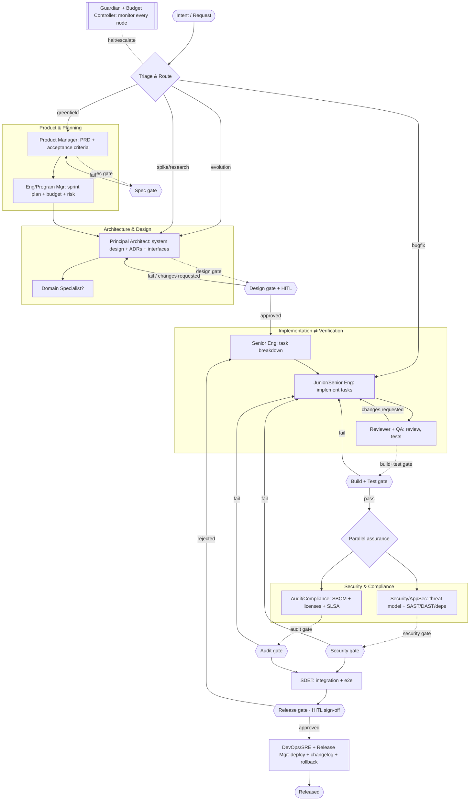

# Architecture — Graph topology, state, and orchestration

This document specifies *how* the Foundry pipeline is wired as a LangGraph
`StateGraph`: the node/subgraph layout, the typed state, the orchestration
patterns, and the control flow (gates, loops, interrupts).

## 1. Top-level graph



The **Guardian + Budget Controller** are cross-cutting: they observe every
node's trajectory (via the observability plane) and can interrupt the graph on
policy violation, loop detection, or budget breach.

## 2. Subgraphs

Each layer is a self-contained subgraph with its own internal SOP chain,
exposing a single typed input and output. This keeps the top-level graph
readable and lets a subgraph (e.g., a domain pack) be swapped wholesale.

- `product_subgraph(intent) -> PRD`
- `architecture_subgraph(PRD) -> Design`
- `implementation_subgraph(Design, tasks) -> Diffs` (contains the evaluator-optimizer loop)
- `assurance_subgraph(Diffs) -> {SecurityReport, AuditReport}` (parallel fan-out)
- `release_subgraph(approved build) -> Release`

## 3. Typed state

```python
from pydantic import BaseModel
from enum import Enum

class Phase(str, Enum):
    TRIAGE = "triage"; PRODUCT = "product"; ARCHITECTURE = "architecture"
    PLANNING = "planning"; IMPLEMENTATION = "implementation"
    ASSURANCE = "assurance"; RELEASE = "release"; DONE = "done"

class GateResult(BaseModel):
    name: str
    passed: bool
    findings: list[str] = []
    deterministic: bool = True          # was this a real oracle or an LLM judge?
    retries: int = 0

class Artifact(BaseModel):
    kind: str                            # "prd" | "adr" | "interface" | "diff" | "test_report" | ...
    uri: str                             # versioned store / git ref
    produced_by: str                     # role/agent id
    version: int = 1

class Budget(BaseModel):
    usd_cap: float
    usd_spent: float = 0.0
    tokens_spent: int = 0
    wallclock_s: float = 0.0

class FactoryState(BaseModel):
    request: str
    route: str | None = None             # greenfield | bugfix | evolution | spike
    phase: Phase = Phase.TRIAGE
    artifacts: list[Artifact] = []
    gates: list[GateResult] = []
    tasks: list[dict] = []               # decomposed work items
    budget: Budget
    required_capabilities: list[str] = []  # drives specialist routing
    human_decisions: list[dict] = []     # HITL sign-offs / rejections
    history: list[dict] = []             # append-only trajectory log
```

State is the single source of truth passed between nodes. Large blobs (diffs,
reports) live in the artifact store and are referenced by URI, not inlined.

## 4. Durability & control flow

- **Checkpointer** — `PostgresSaver` (prod) / `SqliteSaver` (dev). Every super-step is persisted, giving crash recovery, resume, and time-travel debugging for long-horizon runs.
- **Conditional edges** — gate nodes return `pass | fail | escalate`; the edge function routes accordingly.
- **Bounded loops** — each rework loop carries a `retries` counter; exceeding the cap routes to the Human Liaison instead of looping forever.
- **Interrupts (HITL)** — LangGraph `interrupt()` pauses the run at the design gate and release gate; the run resumes from the checkpoint once a human decision is recorded in `human_decisions`.
- **Parallelism** — the assurance fan-out dispatches security and audit nodes concurrently and joins (scatter-gather); independent implementation tasks likewise run in parallel.

## 5. Orchestration patterns → where they appear

| Pattern (Anthropic) | Location in Foundry |
|---|---|
| Routing | `Triage & Route` node |
| Orchestrator-workers | Supervisor delegating to layer subgraphs |
| Evaluator-optimizer | Implementation ⇄ Review/QA loop |
| Parallelization (scatter-gather) | Parallel security + audit; parallel task implementation |
| Prompt chaining | SOP step sequence inside each role node |
| Reflection | Each role self-critiques output before hand-off |
| Human-in-the-loop | Design gate + Release gate interrupts |

## 6. Why structured artifacts (not chat)

Agents communicate by reading/writing typed artifacts (PRD, ADR, interface
contract, test report, diff), following MetaGPT's finding that structured
communication reduces error propagation versus free-form dialogue. Chat is used
only for in-loop critique, never as the system of record.
