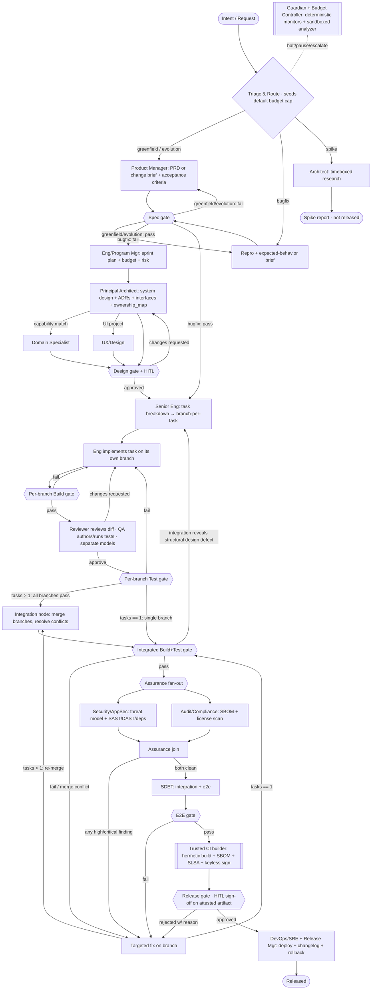

# Architecture — Graph topology, state, and orchestration

This document specifies *how* the Foundry pipeline is wired as a LangGraph
`StateGraph`: the node/subgraph layout, the typed state **and its concurrency
semantics**, the source-control isolation model, durability and side-effect
handling, and the control flow (gates, loops, joins, interrupts).

## 1. Top-level graph



Control-flow rules made explicit (resolving the fan-in/loop hazards):

- **Single-entry / single-exit subgraphs.** Each layer subgraph has exactly one
  entry and one exit node, so loops re-enter at a defined point.
- **Every non-bugfix route is fully specced and budgeted.** Greenfield *and*
  evolution both enter `PROD` (evolution via a *change brief / PRD delta*),
  pass the Spec gate (producing `acceptance_criteria` the Test gate can verify),
  and pass `PLAN` (which sets the budget) before reaching the Architect. **Triage
  seeds a default per-route budget cap** so even the bugfix route (which skips
  `PLAN`) is bounded; `PLAN` refines the cap on the routes it visits.
- **Spikes are throwaway.** A spike routes to a timeboxed Architect research node
  and terminates in a *spike report* — it never enters the implementation/release
  pipeline, so it produces no released artifact.
- **Gate failures return to the producer for that route.** A Spec-gate failure
  routes back to whichever node produced the spec — `PROD` for
  greenfield/evolution, `MINSPEC` for bugfix — preserving the
  single-entry/single-exit loop invariant.
- **Integration is task-count-based, not route-based.** Whenever a run has **more
  than one task branch** it goes through `integration_node`; whenever it has
  **exactly one task** (a bugfix *or* a single-task greenfield/evolution) that
  lone branch *is* the integrated tree and integration is bypassed. The
  predicate on every PTEST/FIX edge is `tasks > 1` vs `tasks == 1`, so no
  legitimate run is left without a defined edge.
- **One re-verification funnel.** *Every* fix — per-task, integration, assurance,
  E2E, or release-rejection — routes through `FIX`. For a **multi-task** run the
  fix is **re-merged through `integration_node`** (producing a new integrated
  tree and `tree_sha`) before the **Integrated Build+Test gate**; for a
  **single-task** run the branch *is* the integrated tree, so `FIX` flows
  straight to the integrated gate. No path skips build/test after a code change.
- **Targeted fixes, not restarts.** Integrated-gate failures, assurance findings,
  E2E failures, and release rejections all route to a *targeted* `FIX`.
  Full re-decomposition (`→ DECOMP`) happens **only** when integration reveals a
  *structural design defect* (that one edge is explicitly labeled).
- **Assurance join.** Security and Audit run in parallel and rejoin at one node;
  the run proceeds only when *both* are clean.
- **E2E is gated.** SDET's end-to-end run is guarded by an **E2E gate** with a
  `fail → FIX` edge, so a failing e2e suite cannot reach release.
- **Attest-then-release.** The trusted builder produces the signature + SLSA
  provenance *before* the Release gate, so the human signs off on an already
  **attested artifact** (the Release gate checks provenance/signature presence).
- **Any single-task run bypasses integration.** A bugfix is the canonical case:
  it produces a reproduction + expected-behavior brief (its acceptance criterion)
  through the Spec gate, then enters `DECOMP`, which provisions **exactly one
  task** (and thus the `task/<id>` branch and `task_id` that the per-branch gates,
  artifacts, and side-effect ledger key on). A single-task greenfield/evolution
  run is handled identically. With one branch, integration is skipped and the
  per-branch result flows straight into the Integrated Build+Test gate.
- **A fix invalidates downstream integrated verdicts.** Because integrated gates
  are keyed on the integrated-tree content hash (§3), and a `FIX` is re-merged
  (multi-task) or directly produces (bugfix) a new tree, the `tree_sha` changes
  and yields a new key — the prior `Security`/`Audit`/`E2E` PASS no longer matches
  the *current* tree, so re-verification re-runs **all** integrated gates
  (Build+Test *and* Security/Audit/E2E), never just Build+Test.

## 2. Subgraphs

Each layer is a self-contained subgraph with a single typed input and output:

- `product_subgraph(intent) -> PRD`
- `architecture_subgraph(PRD) -> Design` (conditionally invokes UX / Domain Specialist — see §7)
- `implementation_subgraph(Design, task) -> branch` (per-task; evaluator-optimizer loop + per-branch Build/Test gates)
- `integration_node(branches[]) -> IntegratedTree` (runs only when `tasks > 1`; merge + conflict resolution)
- `assurance_subgraph(IntegratedTree) -> {SecurityReport, AuditReport}` (parallel fan-out + join)
- `release_subgraph(attested tree) -> Release`

## 3. Typed state and concurrency semantics

LangGraph merges state updates **per channel** at every super-step. Any channel
written by more than one concurrent node **must** declare a reducer, or the run
raises `InvalidUpdateError` (or silently drops a branch). We use a `TypedDict`
state with explicit `Annotated[..., reducer]` channels, and Pydantic models only
for the *values* (artifact contracts). Each channel is labeled **single-writer**
or **fan-in** (reducer required). Custom reducers **must tolerate a `None` left
operand** (the channel's pre-initialization value) and must be **identity-keyed**
so concurrent same-kind writes do not clobber.

```python
import operator
from typing import Annotated, TypedDict
from pydantic import BaseModel
from enum import Enum

# ---- value contracts (Pydantic) ----
class Phase(str, Enum):
    TRIAGE="triage"; PRODUCT="product"; ARCHITECTURE="architecture"
    PLANNING="planning"; IMPLEMENTATION="implementation"; INTEGRATION="integration"
    ASSURANCE="assurance"; RELEASE="release"; DONE="done"

class Artifact(BaseModel):
    kind: str                      # "prd"|"adr"|"interface"|"diff"|"test_report"|...
    uri: str                       # content-addressed store ref — GLOBALLY UNIQUE identity
    produced_by: str               # role/agent id
    task_id: str | None = None     # branch/task this artifact belongs to (parallel-safe)
    version: int = 1               # artifacts are versioned, never mutated in place
    supersedes: str | None = None  # uri of the version this replaces

class GateResult(BaseModel):
    name: str
    passed: bool
    decision_deterministic: bool   # was the PASS/FAIL *rule* deterministic?
    execution_deterministic: bool  # were the underlying outputs reproducible?
    findings: list[str] = []
    retries: int = 0
    run_against: str               # per-branch: "task/<id>"; integrated: the integrated-tree content hash (tree_sha)

class BudgetLedger(BaseModel):
    usd_cap: float
    per_phase_caps: dict[str, float]   # concrete sub-budgets incl. a rework reserve, governance §7
    per_loop_caps: dict[str, float]
    usd_spent: float = 0.0
    tokens_spent: int = 0
    wallclock_s: float = 0.0
    monitor_overhead_usd: float = 0.0  # Guardian/Budget cost is itself metered

class ExternalAction(BaseModel):       # the side-effect ledger (see §5)
    idempotency_key: str               # stable hash of (task, action, target)
    kind: str                          # "commit"|"push"|"open_pr"|"tag"|"deploy"
    status: str                        # "pending"|"done"
    external_ref: str | None = None    # PR#, sha, tag, deployment id

# ---- merge reducers (None-safe, identity-keyed) ----
def merge_artifacts(a, b):
    a = a or []
    by_uri = {x.uri: x for x in a}          # uri is content-addressed => unique identity
    for x in (b or []):
        by_uri[x.uri] = x                   # set-union by identity; no parallel clobber
    return list(by_uri.values())

def merge_gates(a, b):
    a = a or []
    latest = {(g.name, g.run_against): g for g in a}
    for g in (b or []):
        latest[(g.name, g.run_against)] = g  # LATEST verdict per (gate, target) wins
    return list(latest.values())

def union_strs(a, b):
    return sorted(set(a or []) | set(b or []))  # dedup capabilities

# ---- graph state (TypedDict + reducers) ----
class FactoryState(TypedDict):
    request: str                                              # single-writer
    route: str | None                                         # single-writer (triage)
    phase: Phase                                              # single-writer (supervisor)
    required_capabilities: Annotated[list[str], union_strs]   # fan-in, deduped
    artifacts: Annotated[list[Artifact], merge_artifacts]     # fan-in, set-union by uri
    gates: Annotated[list[GateResult], merge_gates]           # fan-in, latest-per-(name,target)
    tasks: Annotated[list[dict], operator.add]                # fan-in (decomp/parallel)
    history: Annotated[list[dict], operator.add]              # fan-in, append-only
    human_decisions: Annotated[list[dict], operator.add]      # fan-in
    budget: BudgetLedger                                      # single-writer (Budget Ctrl)
    actions: Annotated[list[ExternalAction], operator.add]    # fan-in side-effect ledger
```

Key correctness notes:

- **Artifacts are set-unioned by their content-addressed `uri`**, so two parallel
  task branches each emitting (say) a `diff` or `test_report` never collide — the
  earlier bug of keying on `(kind, produced_by, version)` is gone. `task_id`
  attributes each artifact to its branch.
- **`gates` uses a latest-wins keyed reducer** on `(name, run_against)`, so the
  supervisor reads a well-defined *current* verdict. Per-branch runs key on the
  stable `task/<id>` (so retries on the same branch overwrite correctly);
  **integrated runs key on the integrated-tree content hash (`tree_sha`)**, so a
  `FIX` that changes the tree yields a *new* key — prior `Security`/`Audit`/`E2E`
  PASS verdicts no longer match the current tree and cannot be read as current,
  forcing their re-run during re-verification. Append-only verdict history is
  preserved separately in `history` for audit.
- `operator.add` channels (`tasks`, `history`, `human_decisions`, `actions`) are
  LangGraph-initialized to `[]`; the hand-written reducers above are explicitly
  `None`-safe.
- `TypedDict` is chosen for the *graph state* because reducer annotations compose
  cleanly with LangGraph's channel model; Pydantic still validates every value.

## 4. Source-control isolation and integration

- **Branch-per-task / worktree isolation.** Each task gets a branch (`task/<id>`)
  and an isolated worktree in its sandbox. Parallel agents never share a tree.
- **Per-branch gates first.** Build and Test gates run *per task branch* in its
  own sandbox — reproducible and attributable.
- **Explicit integration node (runs when `tasks > 1`).** When all task branches
  pass, `integration_node` merges them in a **deterministic order** driven by the
  Architect's `ownership_map` (topological by declared file/interface ownership,
  then lexical by `task_id` as a tiebreak). Conflicts route to a
  conflict-resolution step (Senior Engineer) with the conflicting hunks as input.
  A multi-task `FIX` re-enters `integration_node` (re-merge), so the integrated
  tree always reflects the fix and its `tree_sha` changes accordingly.
- **Single-task fallback.** Any run with exactly one task (a bugfix or a
  single-task greenfield/evolution) bypasses `integration_node` entirely and its
  lone branch *is* the integrated tree. For multi-task runs that somehow lack an
  `ownership_map`, merge order falls back to lexical `task_id` ordering and is
  flagged for the Architect.
- **Integrated gate is authoritative for release.** Per-branch green does not
  imply integrated green.
- **Retry idempotency.** A branch is reset to a known base before re-running a
  fix, so re-execution never double-applies a diff.

## 5. Durability, resume, and external side effects

LangGraph's checkpointer makes *internal* state resumable — it does **not** undo
external side effects. We separate node types and add a ledger:

- **Pure-compute nodes** (reasoning, producing artifacts) are freely
  re-executable; resume/replay is safe.
- **Effectful nodes** (git commit/push, PR open, package install, tag, deploy)
  are guarded by the **external-action ledger** (`actions` channel). Every
  effectful tool call carries an `idempotency_key`; the node first checks the
  ledger / the external system and is a **check-then-act** no-op if the action is
  already `done`.
- **Checkpointer:** `PostgresSaver` (prod) / `SqliteSaver` (dev) persists every
  super-step → crash recovery and resume.
- **Time-travel** rewinds *internal state only*. Forking from an earlier
  checkpoint creates a **new run ID**; it never mutates the original run's audit
  record (see [governance.md §4](./governance.md)) and never "un-deploys" the
  outside world. Replaying past an effectful node hits the ledger and skips.

## 6. Context assembly, retrieval, and model management

Long-horizon runs accumulate state that exceeds any context window, so each node
has a **context-assembly contract** rather than "dump everything":

- **Per-node window budget.** A node receives: its task/SOP, the *relevant*
  interface contracts, retrieved code spans, and a **summarized** rolling
  history — never the full append-only `history`.
- **History compaction.** `history` is append-only for audit, but nodes consume a
  compacted view: periodic LLM summarization into checkpointed summaries, with
  raw events retained in the store (not the window).
- **Repo retrieval (concretely).** A **symbol index** (tree-sitter/LSP) +
  chunk-level embeddings + lexical search, ranked and reranked, returning bounded
  spans with file/line provenance. The Architect's "survey existing code" is this
  retrieval contract, not free reading.
- **Model pinning & tiers.** Model IDs are pinned per tier (T1=Opus-class,
  T2=Sonnet-class, T3=Haiku-class) and recorded in the run manifest. **Tier
  downgrade is forbidden on T1 judgment nodes** (architecture, security, review);
  a budget breach there **escalates** ([governance.md §7](./governance.md)).
- **Failover.** On rate-limit/unavailability, retry with backoff then fail over
  to the same-tier alternate; never cross-tier-down on T1.
- **Prompt caching.** Stable system prompts/SOPs and pinned reference artifacts
  are sent with cache breakpoints so repeated node invocations reuse cached
  prefixes (a primary token-cost lever alongside tiering).

## 7. Conditional and optional roles

Optional roles are modeled as **conditional edges**, not always-present nodes:

- **UX/Design** is entered only when `required_capabilities` contains `ui`.
- **Domain Specialist** is entered only when `required_capabilities` intersect
  the registry (see [governance.md §5](./governance.md)).
- **Consumers tolerate absence.** Downstream nodes treat optional artifacts
  (`ux_spec`, domain addenda) as optional inputs and use presence checks. The one
  load-bearing exception — integration's dependence on `ownership_map` — has the
  explicit bugfix bypass and lexical fallback defined in §4.

## 8. Orchestration patterns → where they appear

| Pattern (Anthropic) | Location in Foundry |
|---|---|
| Routing | `Triage & Route` node |
| Orchestrator-workers | Supervisor delegating to layer subgraphs |
| Evaluator-optimizer | Per-task Implementation ⇄ Review/QA loop |
| Parallelization (scatter-gather) | Branch-per-task impl; assurance fan-out + join |
| Prompt chaining | SOP step sequence inside each role node |
| Reflection | Each role self-critiques output before hand-off |
| Human-in-the-loop | Design gate + Release gate interrupts |

## 9. Why structured artifacts (not chat)

Agents communicate by reading/writing **content-addressed, versioned** artifacts
(PRD, ADR, interface contract, test report, diff), following MetaGPT's finding
that structured communication reduces error propagation versus free-form
dialogue. Chat is used only for in-loop critique, never as the system of record.
